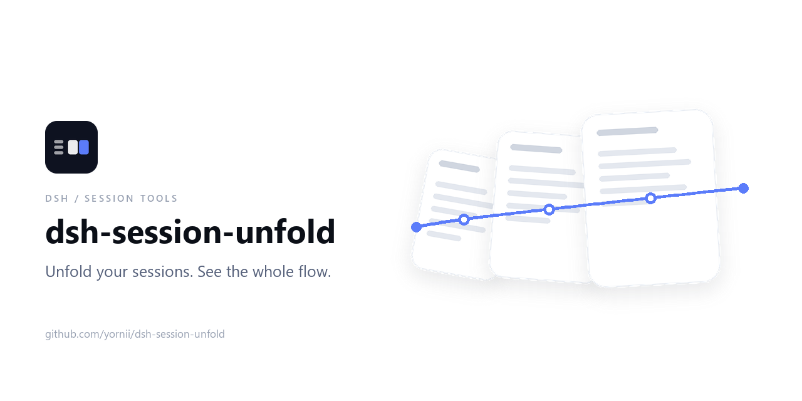
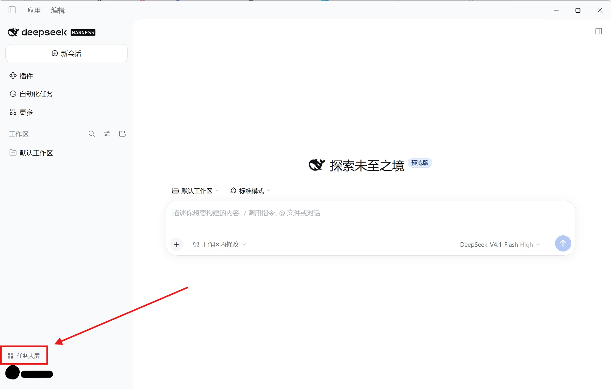
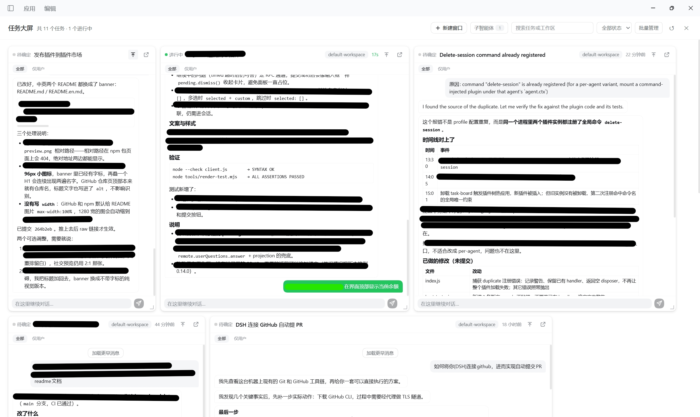

<p align="center">
  
</p>

<p align="center">
  <a href="https://github.com/Yornii/dsh-session-unfold/actions/workflows/ci.yml"></a>
  <a href="https://github.com/Yornii/dsh-session-unfold/blob/main/LICENSE"></a>
  <a href="https://github.com/Yornii/dsh-session-unfold"></a>
</p>

A client-side plugin for [DeepSeek Harness](https://github.com/deepseek-ai/deepseek-harness) (DSH) that turns the sidebar's session list into a full-screen tiling view: one card per session, latest messages at a glance, one click to open.

> 中文说明见 [README.md](README.md).

## 🎯 Why

The session list gives only a title and a timestamp. With many tasks you cannot tell what is running, what waits for you, and what is done. This board lays those signals out on one screen, sorted In progress → Done → To decide, with a reply box on every card.

## ✨ Features

| Feature | Detail |
| --- | --- |
| Full-screen board | Opened from the sidebar footer; Esc or ✕ closes |
| Message timeline | User messages and Markdown-rendered assistant replies; All / User only toggle |
| Clarifying questions | `ask_user_question` prompts show as assistant messages with the answer right after; while pending they can be answered right on the card (pick options or type), and skipped questions say "Skipped" |
| New window | Creates a Session from the header and adds its card without navigating away |
| Status & pin | In progress / Done / To decide inferred and read-only; pinning shares the sidebar's data; the rest sort by recent activity |
| Subagent windows | Header toggle shows subagent Sessions, hidden by default; read-only |
| Card controls | Resize with snapping, double-click to reset, inline rename, a dedicated Open session button |
| Inline reply | Shares the real session draft; Enter sends, Shift+Enter adds a line |
| Drag-and-drop upload | Drop files onto any writable card to upload them into that Session's draft attachments, shared with the real composer; the card shows upload status and attachment count, and Enter sends them together |
| Approvals | A pending approval shows the tool and reason with Allow once / Reject |
| Permanent batch delete | Multi-select deletes windows and Sessions after a second confirmation (needs `dsh-session-delete`) |
| Extras | History paging, search, status filter, workspace chip, running badge, en / zh UI |

## 🖼️ Screenshots

The Task board entry sits at the bottom of the sidebar:

<p align="center">
  
</p>

Opening it lays every Session out on one screen — one card each, with its latest messages, status and pending questions:

<p align="center">
  
</p>

## 📦 Install

```sh
dsh plugin --profile web add @yornni/dsh-session-unfold
```

Until it is on npm, use `dsh plugin --profile web add github:yornii/dsh-session-unfold`, or clone the repository and install the directory containing `package.json` through the plugin manager. After installing, reload the page and a "Task board" button appears at the bottom of the sidebar; uninstalling removes only this plugin and leaves DSH files untouched. Permanent deletion also needs the `dsh-session-delete` plugin that provides `delete-session`.

## ⚙️ Configuration

None required. Card sizes live in the browser-local `dsh.task-board.card-size.v1` key; status is derived read-only: running is "In progress", a just-finished non-main Session with an unread completion notice is "Done", everything else is "To decide".

## 🧩 How it works

- Client-only plugin: all logic lives in `client.js`; it registers `sidebar.footer.action` and `shell.overlay` and overrides nothing.
- Each card calls `ctx.sessions.retain(sessionId)` for the recent event window and re-folds on change; assistant replies render through a safe Markdown subset, other tool calls stay hidden.
- `ask_user_question` questions live in `tool/call` and answers in the `tool/result` with the same `callId`; folding yields an assistant question bubble plus a user answer bubble. While pending, the card renders the live `useSessionStatus` pending interaction as an option panel and submits through `pending.answer({ answers })`, the same waterfall/Remote channel as the composer question card.
- Files dropped on a card become that Session's draft attachments through `scope.get('conversation').createDrafts(sessionId, files, true)`, which starts the uploads; the input shell's `addAttachments` publishes the ids and the card reports upload state. Sending from the card adds each ready `{ type: 'file', receiptId }` block to the prompt and clears the draft attachments afterwards.
- The board is portaled to `document.body` and lifted above the host's full-viewport drag mask (a body portal at `z-index:1000`); file drags stop at the board (and are captured outside it while it is open), so the shell's composer mask never appears or gets left behind in the session view. Drops that miss a card are swallowed by the board instead of falling through to the hidden composer.
- New window uses `ctx.sessions.create`, pinning `uiWorkspace.pinSession`, approvals `approval.answer`, replies `binding.session.prompt(..., 'queue')`, rename `binding.session.rename`.
- The header balance comes from the optional `remote.account` injection: `getBalance({ version, locale, timezoneOffsetSeconds })`, read when the board opens and refreshed every minute. It hides when signed out, unauthorized or failed, and formats `¥`/`$` with two decimals (`<¥0.01` below a cent).
- Subagent rows (`origin === 'subagent'`) stay hidden by default and read-only; status and approvals read `useSessionStatus`; styling uses host theme tokens.

## 🧪 Checks

```bash
node --check client.js
node tools/render-test.mjs
```

`tools/render-test.mjs` renders the board offline with a fake Host and asserts card structure, the message timeline, resize handles and the controls. No browser needed.

## ⚠️ Limitations

- Status and card sizes live in the local browser only; they do not sync across machines.
- Live updates, navigation and size persistence need a running Web page; the offline test does not cover them.
- Permanent deletion needs `dsh-session-delete`; deleted Sessions cannot be restored from the archive.
- Draft sync is text-only; reference chips and attachment previews degrade to plain text when edited from a card.
- Dropped files share the real composer's draft attachments; the card shows only the count, while previews and removal stay in the session composer.
- Approvals and questions can both be handled on the card; plan reviews (`plan-review`) and other pending interactions still need the session.
- Late answers in timed mode and question/answer pairs split across pages are not shown; the board starts with 12 cards and pages in the rest.

## 📄 License

[MIT](LICENSE)
