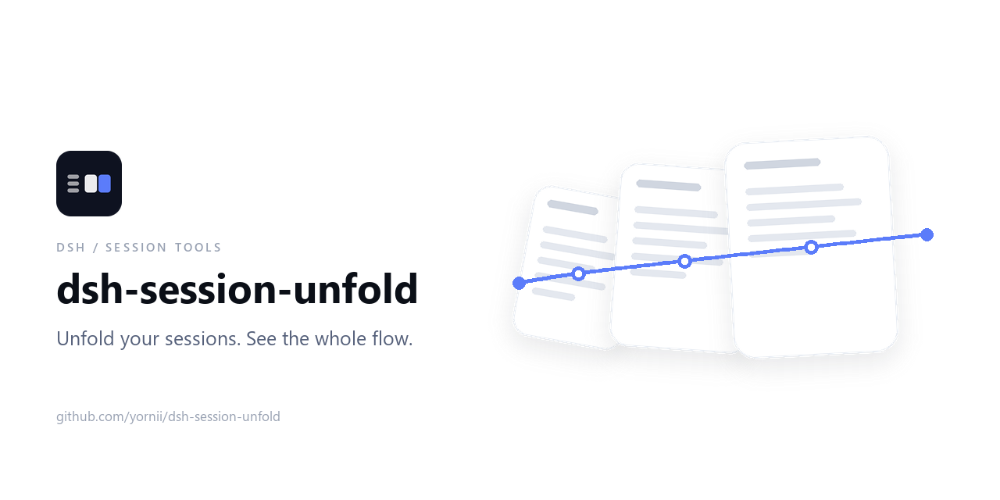

<p align="center">
  
</p>

<p align="center">
  <a href="https://github.com/Yornii/dsh-session-unfold/actions/workflows/ci.yml"></a>
  <a href="https://github.com/Yornii/dsh-session-unfold/blob/main/LICENSE"></a>
  <a href="https://github.com/Yornii/dsh-session-unfold"></a>
</p>

一个 DeepSeek Harness（DSH）Web 客户端插件：把侧边栏的会话列表换成全屏平铺视图，一个会话一张卡片，最近消息一目了然，点开即进。

> English: [README.en.md](README.en.md)

## 🎯 它解决什么

会话列表只给标题和时间，任务一多就分不清哪些在跑、哪些等我拍板、哪些已经完事。这个插件把这些信号铺在一张屏上，按 进行中 → 待确定 → 已完成 排序，并允许就地回一句话。

## ✨ 功能

| 能力 | 说明 |
| --- | --- |
| 全屏大屏 | 左下角「任务大屏」打开，Esc 或 ✕ 关闭 |
| 消息时间线 | 用户消息 + Markdown 助手回复；顶部「全部 / 仅用户」切换 |
| 澄清提问 | `ask_user_question` 的问题按助手消息显示，回答紧随其后；跳过的题标注「已跳过」 |
| 新建窗口 | 顶栏新建会话并加入大屏，不跳转 |
| 状态与置顶 | 进行中 / 待确定 / 已完成 自动推断、只读；置顶与侧栏共用一份数据，其余按活跃时间倒序 |
| 子智能体窗口 | 顶栏开关显示子会话，默认隐藏；纯只读 |
| 卡片操作 | 缩放并吸附其它卡片、双击重置、行内改名、独立「打开会话」按钮 |
| 内联回复 | 与真实输入框共享草稿；回车发送，Shift+Enter 换行 |
| 拖拽上传 | 把文件拖到任一可写窗口即上传到该会话的草稿附件，与真实输入框共用同一份；卡片显示上传状态和附件数，回车发送时一起投递 |
| 权限审批 | 待审批时卡片显示工具与原因，可直接「允许一次 / 拒绝」 |
| 批量永久删除 | 多选后删除窗口及对应会话，需二次确认（依赖 `dsh-session-delete`） |
| 其他 | 历史消息分页、搜索、状态筛选、工作区标签、运行中徽标、中英双语 |

## 📦 安装

```sh
dsh plugin --profile web add @yornii/dsh-session-unfold
```

未发布 npm 时改用 `dsh plugin --profile web add github:yornii/dsh-session-unfold`；也可以克隆仓库，在插件管理器里安装含 `package.json` 的目录。安装后刷新页面，左下角出现「任务大屏」；卸载即移除本插件，不改动 DSH 的任何原有文件。永久删除还需要启用提供 `delete-session` 命令的 `dsh-session-delete` 插件。

## ⚙️ 配置

无需配置。卡片尺寸存在浏览器 localStorage 的 `dsh.task-board.card-size.v1`；状态只读派生：运行中为「进行中」，非主视图会话刚结束且完成提醒未读为「已完成」，其余为「待确定」。

## 🧩 实现要点

- 纯客户端插件，逻辑全在 `client.js`；注册 `sidebar.footer.action` 与 `shell.overlay` 两个槽位，不覆盖任何已有 UI。
- 卡片通过 `ctx.sessions.retain(sessionId)` 读取事件窗口并订阅变化；助手回复走内置安全 Markdown 子集，其他工具调用不显示。
- `ask_user_question` 的问题在 `tool/call`、回答在同 `callId` 的 `tool/result`，折叠成「助手问题气泡 + 用户回答气泡」。
- 拖到卡片的文件通过 `scope.get('conversation').createDrafts(sessionId, files, true)` 注册为该会话的草稿附件并自动开始上传，再由输入框 shell 的 `addAttachments` 发布；卡片内回车发送时把就绪上传的 `receiptId` 以 `{ type: 'file', receiptId }` 一并投递，成功后清理草稿附件。
- 大屏通过 `createPortal` 挂到 `document.body` 并置于宿主拖拽蒙版（body portal，`z-index:1000`）之上；同时文件拖拽事件在大屏内停止冒泡、在大屏外的文档捕获阶段被拦截，宿主会话的全屏蒙版不会出现也不会残留到会话界面。落在卡片外的文件由大屏吞掉，不会误投给背后的会话输入框。
- 新建窗口走 `ctx.sessions.create`，置顶走 `uiWorkspace.pinSession`，审批走 `approval.answer`，回复走 `binding.session.prompt(..., 'queue')`，改名走 `binding.session.rename`。
- 子会话取 `origin === 'subagent'` 且只读；状态与审批读 `useSessionStatus`；样式全部使用宿主主题变量。

## 🧪 自检

```bash
node --check client.js
node tools/render-test.mjs
```

`tools/render-test.mjs` 用假 Host 离线渲染大屏，断言卡片结构、消息时间线、尺寸手柄与控件，不依赖浏览器。

## ⚠️ 已知限制

- 状态与窗口尺寸只存在本机浏览器，换机器不同步。
- 实时刷新、跳转导航与尺寸持久化依赖真实页面，离线测试覆盖不到。
- 永久删除依赖 `dsh-session-delete`，删除后不能从「已归档」恢复。
- 草稿同步只同步文本，引用 chip / 附件预览从卡片改写会退化为纯文本。
- 拖拽上传的附件与真实输入框共用同一份草稿附件；卡片只显示附件数量，预览和移除在会话输入框里完成。
- 审批卡片只覆盖审批类交互，计划审阅、提问等仍需进入会话。
- timed 提问的迟到回答、被分页切开的问题与回答不显示；大屏初始 12 个窗口，其余靠「再看 N 个」翻页。

## 📄 许可

[MIT](LICENSE)
